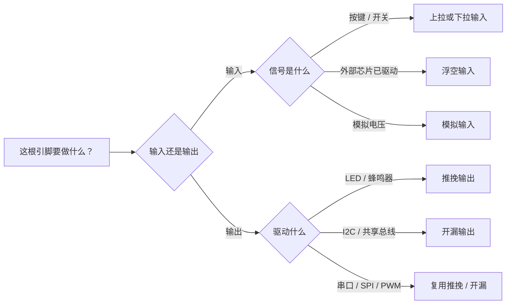
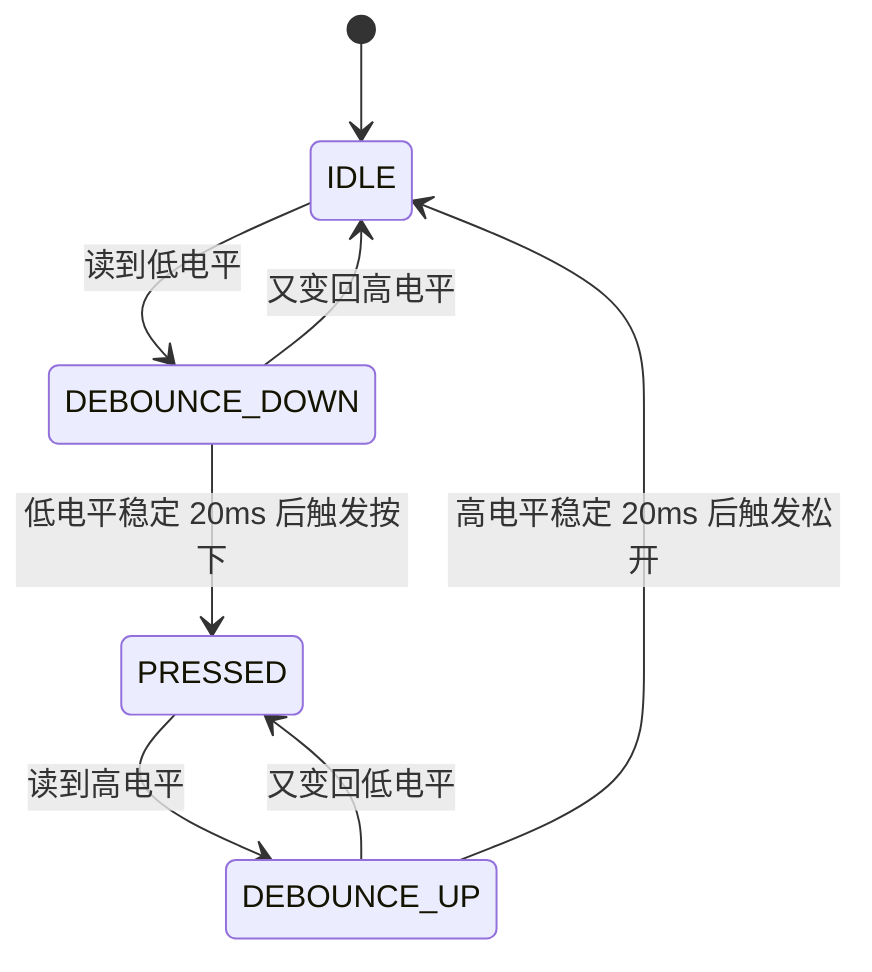

第 02 篇我们让 LED 闪了起来，但只用了 GPIO 的“输出”这一半能力。这一篇把引脚彻底讲清楚：**它内部长什么样、八种模式分别是什么、为什么按键要配上拉、推挽和开漏到底差在哪、抖动该怎么消**。

内容大致分三层：

- **基础**（一～五）：内部结构、八种模式、HAL 接口、CubeMX 配置、按下亮实验
- **进阶**（六～七）：按键抖动、边沿检测、四状态机、按一下翻一次
- **实战**（八～十一）：电气参数、外设配置速查、寄存器视角、调试排错

GPIO 是后面串口、I2C、SPI、PWM 的地基。地基打歪了，后面全是玄学问题。（野兽派自己看着办）

## 本篇目标

- 说清引脚、端口、位的关系，以及一根 GPIO 内部有哪些电路
- 看懂 `CRL/CRH` 里 `MODE` 和 `CNF` 的编码
- 分清八种工作模式，能根据场景选型
- 理解上拉、下拉、推挽、开漏、复用分别解决什么问题
- 熟练使用 HAL 的 GPIO 接口，并知道它底层写了哪个寄存器
- 用 CubeMX 配置按键输入，用轮询读取电平
- 写出“按一下翻一次”的稳定代码，理解消抖和边沿检测
- 会算 LED 限流电阻，知道 3.3V、5V、电流和 PC13 的限制
- 掌握用万用表、示波器、ST-Link 排查 GPIO 问题的方法

## 一、把“引脚”拆开看

### 1. 引脚、端口、位

这三个词经常混着用，先分清：

- **引脚（Pin）**：芯片封装上真正能焊线、插杜邦线的那根金属脚
- **端口（Port）**：一组最多 16 根引脚，用 `GPIOA`、`GPIOB`、`GPIOC` 这样的名字管理
- **位（Bit）**：引脚在端口里的编号，0～15

所以 `PA5` 读作“端口 A 的第 5 号引脚”，代码里写成 `GPIOA` + `GPIO_PIN_5`。

STM32F103C8T6 是 48 脚封装，实际引出的 IO 如下：

| 端口 | 可用引脚 | 数量 |
| --- | --- | --- |
| GPIOA | PA0～PA15 | 16 |
| GPIOB | PB0～PB15 | 16 |
| GPIOC | PC13～PC15 | 3 |
| GPIOD | PD0、PD1 | 2 |
| 合计 |  | **37** |

注意：`PA5` 和 `PB5` 都叫“5 号”，但它们是两个完全不同的物理引脚。写代码时端口和引脚必须成对出现。

### 2. 一根 GPIO 内部有什么

很多人以为 GPIO 就是一根线，其实芯片内部有一小套电路：


逐个解释：

| 部件 | 作用 | 你需要知道的 |
| --- | --- | --- |
| 保护二极管 | 把引脚电压钳在 VSS～VDD 附近 | 只能扛瞬间静电，不能拿来长期限压 |
| 上拉 / 下拉电阻 | 给输入引脚一个默认电平 | 约 30～50kΩ，只在输入模式下有效 |
| 施密特触发器 | 把缓慢变化的信号整形成干净的高低电平 | 有一定迟滞，抗抖动；模拟模式下会关闭 |
| `IDR` | 输入数据寄存器 | 读它得到引脚**实际**电平 |
| `ODR` | 输出数据寄存器 | 写它决定输出电平；输入模式下还负责选上拉还是下拉 |
| 输出级 | PMOS + NMOS | 推挽时两个都用，开漏时只用下面那个 NMOS |
| 复用功能 | 把引脚交给串口、SPI 等外设 | 配成复用模式后，引脚由外设控制 |

理解这张图的直接好处：**“读引脚”读的是 `IDR`，“写引脚”写的是 `ODR`/`BSRR`，上下拉是另一套开关**。很多“配了没反应”的问题，都是把这几件事混在了一起。

### 3. 寄存器地图

GPIO 本质是一组内存映射寄存器。F103 的端口基地址：

| 端口 | 基地址 |
| --- | --- |
| GPIOA | `0x40010800` |
| GPIOB | `0x40010C00` |
| GPIOC | `0x40011000` |
| GPIOD | `0x40011400` |

每个端口内部的寄存器布局一样：

| 寄存器 | 偏移 | 复位值 | 访问 | 作用 |
| --- | --- | --- | --- | --- |
| `CRL` | 0x00 | 0x44444444 | 读写 | 配置 Pin 0～7 |
| `CRH` | 0x04 | 0x44444444 | 读写 | 配置 Pin 8～15 |
| `IDR` | 0x08 | 由引脚电平决定 | 只读 | 读引脚实际电平 |
| `ODR` | 0x0C | 0x00000000 | 读写 | 输出锁存 / 上下拉选择 |
| `BSRR` | 0x10 | 0x00000000 | 只写 | 原子置位 / 复位 |
| `BRR` | 0x14 | 0x00000000 | 只写 | 原子复位 |
| `LCKR` | 0x18 | 0x00000000 | 读写 | 锁定配置 |

复位值 `0x44444444` 很值得记：每个引脚 4 位，`0x4 = 0b0100`，也就是 `CNF=01、MODE=00`——**浮空输入**。所以芯片刚上电时，所有 GPIO 都是高阻输入，电平由外部电路决定。

### 4. `CRL` / `CRH` 的 4 位编码

`CRL` 管 Pin 0～7，`CRH` 管 Pin 8～15。每根引脚占 4 位：

- `MODE[1:0]`：输入还是输出、输出速度
- `CNF[1:0]`：具体模式

**输入模式（MODE = 00）**：

| CNF | 模式 | 说明 |
| --- | --- | --- |
| 00 | 模拟输入 | 施密特触发器关闭，给 ADC 用 |
| 01 | 浮空输入 | 复位默认，高阻，电平完全由外部决定 |
| 10 | 上拉 / 下拉输入 | 具体方向由 `ODR` 对应位决定：1 上拉，0 下拉 |
| 11 | 保留 | 不要用 |

**输出模式（MODE ≠ 00）**：

| CNF | 模式 | 说明 |
| --- | --- | --- |
| 00 | 通用推挽输出 | 普通点灯、数字输出 |
| 01 | 通用开漏输出 | I2C、共享总线 |
| 10 | 复用推挽输出 | 串口 TX、SPI、PWM |
| 11 | 复用开漏输出 | I2C 的 SCL/SDA |

**输出速度编码**（F1 的编码不是按顺序递增的，容易记错）：

| MODE[1:0] | 速度 |
| --- | --- |
| 00 | 输入模式 |
| 01 | 输出，最高 10 MHz |
| 10 | 输出，最高 2 MHz |
| 11 | 输出，最高 50 MHz |

举个例子：把 `PA5` 配成“推挽输出、2 MHz”，PA5 在 `CRL` 的 `[23:20]` 位，`MODE=10、CNF=00`，所以这 4 位是 `0b0010`，即 `0x2`：

```c
GPIOA->CRL &= ~(0xF << 20);   // 先清空 PA5 的 4 位
GPIOA->CRL |=  (0x2 << 20);   // MODE=10（2MHz），CNF=00（推挽）
```

### 5. 为什么必须先开时钟

STM32 为了省电，每个外设都有独立的时钟开关。GPIOA/B/C 挂在 **APB2** 总线上，对应 `RCC_APB2ENR` 里的 `IOPAEN`、`IOPBEN`、`IOPCEN` 位。

时钟没开时，你对 GPIO 寄存器的写入**不会生效**，读回来也不是你想要的值。这不是“配置错了”，而是这个外设根本没被供电。

HAL 里对应的宏：

```c
__HAL_RCC_GPIOA_CLK_ENABLE();   // 开 GPIOA 时钟
__HAL_RCC_GPIOB_CLK_ENABLE();   // 开 GPIOB 时钟
__HAL_RCC_GPIOC_CLK_ENABLE();   // 开 GPIOC 时钟
```

CubeMX 生成的 `MX_GPIO_Init()` 第一段就是这些宏。自己手写初始化时，这一步千万别忘。

## 二、八种工作模式

### 1. 总表

先把八种模式放在一张表里，后面再逐个展开：

| 模式 | MODE | CNF | HAL `Mode` | HAL `Pull` | 典型用途 | 注意 |
| --- | --- | --- | --- | --- | --- | --- |
| 模拟输入 | 00 | 00 | `GPIO_MODE_ANALOG` | `GPIO_NOPULL` | ADC 采样、未用引脚 | `IDR` 读数无意义 |
| 浮空输入 | 00 | 01 | `GPIO_MODE_INPUT` | `GPIO_NOPULL` | 外部已有强驱动 | 悬空时电平乱跳 |
| 上拉输入 | 00 | 10 | `GPIO_MODE_INPUT` | `GPIO_PULLUP` | 按键接 GND | `ODR=1` |
| 下拉输入 | 00 | 10 | `GPIO_MODE_INPUT` | `GPIO_PULLDOWN` | 按键接 3.3V | `ODR=0` |
| 推挽输出 | 01/10/11 | 00 | `GPIO_MODE_OUTPUT_PP` | `GPIO_NOPULL` | LED、蜂鸣器 | 不能并联 |
| 开漏输出 | 01/10/11 | 01 | `GPIO_MODE_OUTPUT_OD` | `GPIO_NOPULL` | I2C、共享总线 | 高电平靠外接上拉 |
| 复用推挽 | 01/10/11 | 10 | `GPIO_MODE_AF_PP` | `GPIO_NOPULL` | 串口 TX、SPI、PWM | 由外设控制 |
| 复用开漏 | 01/10/11 | 11 | `GPIO_MODE_AF_OD` | `GPIO_NOPULL` | I2C 的 SCL/SDA | 高电平靠外接上拉 |

| 模式名称 | 性质 | 特征 |
| :--- | :--- | :--- |
| 浮空输入 | 数字输入 | 可读取引脚电平，若引脚悬空，则电平不确定 |
| 上拉输入 | 数字输入 | 可读取引脚电平，内部连接上拉电阻，悬空时默认高电平 |
| 下拉输入 | 数字输入 | 可读取引脚电平，内部连接下拉电阻，悬空时默认低电平 |
| 模拟输入 | 模拟输入 | GPIO无效，引脚直接接入内部ADC |
| 开漏输出 | 数字输出 | 可输出引脚电平，高电平为高阻态，低电平接VSS |
| 推挽输出 | 数字输出 | 可输出引脚电平，高电平接VDD，低电平接VSS |
| 复用开漏输出 | 数字输出 | 由片上外设控制，高电平为高阻态，低电平接VSS |
| 复用推挽输出 | 数字输出 | 由片上外设控制，高电平接VDD，低电平接VSS |

HAL 把“上下拉”拆成了独立的 `Pull` 字段，所以写代码时是 `Mode` 和 `Pull` 两件事组合。比如“上拉输入”不是单独一个 `GPIO_MODE_PULLUP`，而是：

```c
gpio.Mode = GPIO_MODE_INPUT;
gpio.Pull = GPIO_PULLUP;
```

### 2. 四种输入模式

#### 浮空输入

引脚内部什么都不接，呈**高阻态**。电压完全由外部电路决定。

- 适合：外部芯片已经有明确的推挽输出，或者外部已经有上拉/下拉电阻
- 不适合：按键、开关这种“断开时什么都没接”的场景
- 危险：悬空引脚相当于一根小天线，会随环境噪声乱跳，既可能误触发，也会增加功耗

芯片复位后所有引脚默认就是浮空输入，所以“没配置的引脚”并不是“低电平”，而是“不知道是什么电平”。

#### 上拉 / 下拉输入

内部通过一个约 30～50kΩ 的电阻，把引脚接到 VDD 或 GND：

- **上拉**：默认高电平，外部拉低才变低
- **下拉**：默认低电平，外部拉高才变高

按键最常用的接法就是“**引脚开上拉，按键另一端接 GND**”：

```text
        PA0（内部上拉，平时为高）
         │
       ┌─┴─┐
       │按键│
       └─┬─┘
         │
        GND
```

松开时读到高，按下时被 GND 拉低。按下的电流大约是：

```text
I = 3.3V / 40kΩ ≈ 82µA
```

非常小，不会给电源添负担。

> [!TIP] 上拉配 GND，下拉配 3.3V
>
> 这是最不容易记错的口诀。上拉输入如果按键另一端接 3.3V，按下和松开都是高，程序永远认为没按；下拉输入接 GND 也是同样的道理。

内部上拉虽然方便，但有两个局限：

1. **阻值不精确**，30～50kΩ 随芯片、温度变化，不适合做精密分压
2. **驱动能力弱**，不能拿来当 I2C 的上拉，也不能驱动负载

#### 模拟输入

模拟模式下，施密特触发器被关闭，上下拉也断开，引脚直接连到 ADC 的采样电路。

- 用途：ADC 采集电压
- 注意：此时 `IDR` 读数没有意义，不要拿它判断高低
- 低功耗技巧：产品里没用到的引脚，通常配成模拟输入，避免浮空引脚来回翻转造成功耗

#### 输入模式怎么选

| 场景 | 推荐模式 | 原因 |
| --- | --- | --- |
| 按键 / 拨码开关，另一端接 GND | 上拉输入 | 默认高，按下低 |
| 按键 / 拨码开关，另一端接 3.3V | 下拉输入 | 默认低，按下高 |
| 外部芯片推挽输出 | 浮空输入 | 不干扰外部驱动 |
| 外部芯片开漏输出 | 上拉输入 | 需要上拉才能得到高电平 |
| 电位器 / 传感器模拟电压 | 模拟输入 | 交给 ADC |
| 未使用的引脚 | 模拟输入 | 降低功耗、减少干扰 |

### 3. 四种输出模式

#### 推挽输出

内部上面一个 PMOS 接 VDD，下面一个 NMOS 接 GND：

- 输出高：PMOS 导通，引脚主动“推”出 3.3V
- 输出低：NMOS 导通，引脚主动“拉”到 GND
- 既能**拉电流**（source），也能**灌电流**（sink）

点 LED、驱动蜂鸣器、普通数字输出都用它。

> [!CAUTION] 推挽输出不能直接并联
>
> 两个推挽输出连在一起，一个输出高、一个输出低时，电流会从上面的 PMOS 直接灌到下面的 NMOS，形成短路，可能烧坏引脚。需要“线与”时，用开漏。

#### 开漏输出

只有下面的 NMOS，没有上面的 PMOS：

- 输出低：NMOS 导通，把线拉到 GND
- 输出高：NMOS 关断，引脚**高阻态**，自己不会输出高电平
- 想得到高电平，**必须外接上拉电阻**

```text
推挽：                  开漏：
   VDD                     VDD
    │                       │
   PMOS                   上拉电阻
    │                       │
    ├── 引脚                ├── 引脚
    │                       │
   NMOS                    NMOS
    │                       │
   GND                     GND
```

开漏的价值在于“**线与**”：多个设备都把线拉低时，只要有一个拉低，整条线就是低；所有设备都释放时，由上拉电阻送回高电平。I2C 的 SDA/SCL 就是这么工作的。

开漏还能做**电平转换**：3.3V 的 MCU 和 5V 的器件共享一根开漏总线，上拉拉到哪里，高电平就是多少。前提是 MCU 引脚本身耐 5V（FT 引脚），并且两边共地。

用开漏点 LED 时要注意方向：开漏只能“拉低”，所以 LED 应该接在 VDD 和引脚之间，让引脚灌电流；如果 LED 接在引脚和 GND 之间，开漏输出高时是高阻，灯不会亮。

#### 复用推挽 / 复用开漏

这两种模式下，引脚不再由 `ODR` 控制，而是交给片上外设（串口、SPI、I2C、定时器等）。

- 串口 TX、SPI SCK/MOSI、PWM 输出：复用推挽
- I2C 的 SCL/SDA：复用开漏
- 串口 RX、SPI MISO：通常配成输入（浮空或上拉），不是输出

> [!NOTE] F1 的复用功能不需要选 AF 编号
>
> STM32F4 配复用时要写 `GPIO_InitStruct.Alternate = GPIO_AF7_USART1`，因为一个引脚能复用成很多外设。F1 没有这个字段：把引脚配成 `GPIO_MODE_AF_PP` 或 `GPIO_MODE_AF_OD` 后，具体连到哪个外设由外设自己的配置决定。看到 F4 的代码不要直接往 F1 上套。

#### 输出速度

`GPIO_SPEED_FREQ_LOW / MEDIUM / HIGH` 控制的是引脚翻转的**斜率**，不是“程序跑多快”。F1 只有三档：

| HAL 常量 | 对应速度 | 适用场景 |
| --- | --- | --- |
| `GPIO_SPEED_FREQ_LOW` | 2 MHz | 点灯、按键、低速数字信号 |
| `GPIO_SPEED_FREQ_MEDIUM` | 10 MHz | 一般外设 |
| `GPIO_SPEED_FREQ_HIGH` | 50 MHz | SPI、较高频 PWM |

选择原则：**够用就好，越低越稳**。速度越高，边沿越陡，EMI、过冲和功耗越大。点一颗 LED 用 50 MHz，除了让示波器上的波形更“漂亮”，没有任何好处。

### 4. 推挽 vs 开漏：三个场景对比

| 场景 | 推挽 | 开漏 |
| --- | --- | --- |
| 点 LED（LED 接引脚到 GND） | 高电平点亮，能主动输出高 | 高阻，点不亮，需要改接法或加上拉 |
| 两个输出连在一起 | 可能短路，禁止 | 可以线与，低电平优先 |
| I2C 总线 | 不允许，会冲突 | 必须用，配合外部上拉 |

### 5. 模式选择流程图



## 三、HAL 里的 GPIO 接口

### 1. 初始化结构体逐字段

```c
GPIO_InitTypeDef gpio = {0};

gpio.Pin   = GPIO_PIN_0;              // 哪根引脚
gpio.Mode  = GPIO_MODE_INPUT;         // 工作模式
gpio.Pull  = GPIO_PULLUP;             // 上下拉
gpio.Speed = GPIO_SPEED_FREQ_LOW;     // 输出速度
HAL_GPIO_Init(GPIOA, &gpio);
```

| 字段 | 可选值 | 说明 |
| --- | --- | --- |
| `Pin` | `GPIO_PIN_0`～`GPIO_PIN_15`、`GPIO_PIN_All` | 可用按位或一次选多根 |
| `Mode` | `GPIO_MODE_INPUT`、`GPIO_MODE_OUTPUT_PP`、`GPIO_MODE_OUTPUT_OD`、`GPIO_MODE_AF_PP`、`GPIO_MODE_AF_OD`、`GPIO_MODE_ANALOG` | 还包括 `GPIO_MODE_IT_*` 中断模式 |
| `Pull` | `GPIO_NOPULL`、`GPIO_PULLUP`、`GPIO_PULLDOWN` | 只在输入模式下有意义 |
| `Speed` | `GPIO_SPEED_FREQ_LOW`、`MEDIUM`、`HIGH` | 只在输出模式下有意义 |

F1 的 `GPIO_InitTypeDef` **没有** `Alternate` 字段，这一点和 F4 不同。

### 2. 初始化顺序

推荐顺序：

1. 使能端口时钟
2. 如果是输出，先写入初始电平
3. 填结构体，调用 `HAL_GPIO_Init`
4. 如果是输入上下拉，HAL 会自动设置 `ODR` 对应位

```c
GPIO_InitTypeDef gpio = {0};           // 先声明（C90 要求声明在语句前）

__HAL_RCC_GPIOC_CLK_ENABLE();          // 1. 开时钟
__HAL_RCC_GPIOA_CLK_ENABLE();

HAL_GPIO_WritePin(GPIOC, GPIO_PIN_13, GPIO_PIN_SET);  // 2. 先给高电平

gpio.Pin = GPIO_PIN_13;                // 3. 配输出
gpio.Mode = GPIO_MODE_OUTPUT_PP;
gpio.Pull = GPIO_NOPULL;
gpio.Speed = GPIO_SPEED_FREQ_LOW;
HAL_GPIO_Init(GPIOC, &gpio);

gpio.Pin = GPIO_PIN_0;                 // 4. 配上拉输入
gpio.Mode = GPIO_MODE_INPUT;
gpio.Pull = GPIO_PULLUP;
HAL_GPIO_Init(GPIOA, &gpio);
```

为什么输出要先写电平再切模式？因为引脚从“高阻输入”切成“推挽输出”的瞬间，如果 `ODR` 还是 0，引脚就可能先被拉低，产生一个毛刺。先写好 `ODR`，再打开输出级，引脚一上来就是想要的状态。

### 3. 读、写、翻转的底层

| HAL 函数 | 底层操作 | 说明 |
| --- | --- | --- |
| `HAL_GPIO_ReadPin` | 读 `IDR` 的对应位 | 返回 `GPIO_PIN_SET` 或 `GPIO_PIN_RESET` |
| `HAL_GPIO_WritePin` | 写 `BSRR` | 置位写低 16 位，复位写高 16 位 |
| `HAL_GPIO_TogglePin` | 先读 `ODR`，再写 `BSRR` | 读取和写入不是一步完成 |
| `HAL_GPIO_LockPin` | 写 `LCKR` 锁定序列 | 锁定后直到复位才能改配置 |
| `HAL_GPIO_DeInit` | 把 `CRL/CRH` 恢复默认 | 引脚回到浮空输入 |

等价的寄存器写法：

```c
uint32_t odr;

// 读 PA5
if ((GPIOA->IDR & GPIO_PIN_5) != 0) { /* 高 */ }

// 写 PA5 高 / 低
GPIOA->BSRR = GPIO_PIN_5;             // 置位
GPIOA->BSRR = (uint32_t)GPIO_PIN_5 << 16;  // 复位
GPIOA->BRR  = GPIO_PIN_5;             // 也可以只用 BRR 复位

// 翻转 PA5
odr = GPIOA->ODR;
GPIOA->BSRR = ((odr & GPIO_PIN_5) << 16) | (~odr & GPIO_PIN_5);
```

`HAL_GPIO_TogglePin` 的实现就是最后那三行。它先读 `ODR`，再根据当前值写 `BSRR`。在单线程里没问题，但如果主循环和中断同时翻转同一根引脚，读和写之间可能被打断，导致翻转次数不对。要求严格时，用 `BSRR` 直接置位/复位，或者用软件标志协调。

### 4. 一次配置多根引脚

```c
gpio.Pin = GPIO_PIN_0 | GPIO_PIN_1 | GPIO_PIN_2;
gpio.Mode = GPIO_MODE_OUTPUT_PP;
gpio.Pull = GPIO_NOPULL;
gpio.Speed = GPIO_SPEED_FREQ_LOW;
HAL_GPIO_Init(GPIOA, &gpio);
```

一次配置的引脚会共用同一套参数。想给不同引脚不同模式，就分多次调用。

`GPIO_PIN_All` 可以选中整个端口，但通常只在小实验里用，产品里不要一把梭。

### 5. 常见误区

| 误区 | 正确做法 |
| --- | --- |
| 输出模式也设 `GPIO_PULLUP`，以为开漏就有内部上拉 | F1 输出模式下上下拉无效，开漏要输出高电平必须外接上拉 |
| 以为 `GPIO_MODE_AF_PP` 会自动选外设 | F1 还要配置对应外设，复用功能由外设决定 |
| 用 `GPIO_MODE_IT_RISING` 当普通输入 | 这是“输入 + 外部中断”，还需要配 EXTI 和 NVIC |
| 用 `GPIO_PIN_0` 当数值 0 参与运算 | 它是位掩码 `0x0001`，不是引脚编号 |
| 忘了开时钟 | 先 `__HAL_RCC_GPIOA_CLK_ENABLE()` |
| 用 `ODR |=` 改单个引脚 | 用 `BSRR` 原子操作，避免读改写误伤 |
| 读输出引脚时用 `ODR` 判断实际电平 | 开漏输出高时 `ODR=1`，但引脚可能被外部拉低；要看 `IDR` |
| `HAL_GPIO_ReadPin` 返回值当 `int` 用 | 它是 `GPIO_PinState` 枚举，和 `GPIO_PIN_SET/RESET` 比较 |

## 四、CubeMX 配置：加一个按键

### 1. 打开工程

在第 02 篇的工程基础上继续：双击 `led_blink.ioc` 重新打开 CubeMX。也可以新建一个 `gpio_key` 工程，芯片选 **STM32F103C8Tx**。

SYS → Debug 选 **Serial Wire**，RCC → HSE 选 **Crystal/Ceramic Resonator**，时钟树配到 72 MHz，这些和第 02 篇完全一样。

### 2. 逐项配置引脚

在芯片图上左键点击引脚，选择模式：

- **PA0** → `GPIO_Input`
- **PC13** → `GPIO_Output`（板载 LED）
- **PA5** → `GPIO_Output`（外接 LED，可选）

然后进入左侧 **System Core → GPIO**，按下面设置：

| 引脚 | GPIO mode | GPIO Pull-up/Pull-down | Maximum output speed | User Label | 初始电平 |
| --- | --- | --- | --- | --- | --- |
| PA0 | Input mode | **Pull-up** | — | `KEY` | — |
| PC13 | Output Push Pull | No pull-up/pull-down | Low | `LED` | High |
| PA5 | Output Push Pull | No pull-up/pull-down | Low | `LED_EXT` | Low |

几个容易忽略的点：

- **User Label** 不是装饰。CubeMX 会根据它在 `main.h` 里生成 `KEY_Pin`、`KEY_GPIO_Port` 这样的宏，代码里就不用写死 `GPIO_PIN_0`。
- **GPIO output level** 是“上电初始电平”，不是“按下时的电平”。PC13 设 High 是因为板载 LED 低电平点亮，High 表示上电熄灭。
- **Maximum output speed** 点灯选 Low 就够。
- 输入引脚的 **Pull-up/Pull-down** 必须显式选，默认是 No pull，也就是浮空。

> [!NOTE] PA0 还是 WKUP 引脚
>
> PA0 同时是唤醒引脚 WKUP。普通按键输入完全不受影响；只有做待机唤醒时才需要额外配置。这里放心用。

### 3. 生成代码逐行看

Project Manager 里工具链仍选 **MDK-ARM**，生成后打开 `Core/Src/main.c`。CubeMX 会生成：

```c title="Core/Src/main.c（CubeMX 生成部分）" showLineNumbers
static void MX_GPIO_Init(void)
{
    GPIO_InitTypeDef GPIO_InitStruct = {0};

    /* GPIO Ports Clock Enable */
    __HAL_RCC_GPIOC_CLK_ENABLE();
    __HAL_RCC_GPIOA_CLK_ENABLE();

    /* 输出初始电平：两颗 LED 上电都熄灭 */
    HAL_GPIO_WritePin(LED_GPIO_Port, LED_Pin, GPIO_PIN_SET);           // PC13 高 = 灭
    HAL_GPIO_WritePin(LED_EXT_GPIO_Port, LED_EXT_Pin, GPIO_PIN_RESET); // PA5 低 = 灭

    /* PC13：推挽输出 */
    GPIO_InitStruct.Pin   = LED_Pin;
    GPIO_InitStruct.Mode  = GPIO_MODE_OUTPUT_PP;
    GPIO_InitStruct.Pull  = GPIO_NOPULL;
    GPIO_InitStruct.Speed = GPIO_SPEED_FREQ_LOW;
    HAL_GPIO_Init(LED_GPIO_Port, &GPIO_InitStruct);

    /* PA5：推挽输出 */
    GPIO_InitStruct.Pin = LED_EXT_Pin;
    HAL_GPIO_Init(LED_EXT_GPIO_Port, &GPIO_InitStruct);

    /* PA0：上拉输入 */
    GPIO_InitStruct.Pin  = KEY_Pin;
    GPIO_InitStruct.Mode = GPIO_MODE_INPUT;
    GPIO_InitStruct.Pull = GPIO_PULLUP;
    HAL_GPIO_Init(KEY_GPIO_Port, &GPIO_InitStruct);
}
```

逐段对应前面讲过的知识：

1. `__HAL_RCC_*_CLK_ENABLE()`：开时钟，否则后面全白写
2. `HAL_GPIO_WritePin`：先把输出锁存器设成“熄灭”对应的电平
3. PC13 配置：推挽、无上下拉、低速
4. PA0 配置：输入、上拉，HAL 内部会把 `ODR` 的 bit0 置 1 来选择上拉

### 4. 不用 CubeMX 的手写版本

如果哪天没有 CubeMX，或者想在已有工程里加引脚，可以手写：

```c
static void GPIO_Init_Manual(void)
{
    GPIO_InitTypeDef gpio = {0};

    __HAL_RCC_GPIOA_CLK_ENABLE();
    __HAL_RCC_GPIOC_CLK_ENABLE();

    // PC13 推挽输出，初始高电平（板载 LED 灭）
    HAL_GPIO_WritePin(GPIOC, GPIO_PIN_13, GPIO_PIN_SET);
    gpio.Pin   = GPIO_PIN_13;
    gpio.Mode  = GPIO_MODE_OUTPUT_PP;
    gpio.Pull  = GPIO_NOPULL;
    gpio.Speed = GPIO_SPEED_FREQ_LOW;
    HAL_GPIO_Init(GPIOC, &gpio);

    // PA0 上拉输入
    gpio.Pin  = GPIO_PIN_0;
    gpio.Mode = GPIO_MODE_INPUT;
    gpio.Pull = GPIO_PULLUP;
    HAL_GPIO_Init(GPIOA, &gpio);
}
```

这段代码和 CubeMX 生成的本质完全一样，只是没有用 `KEY_Pin` 这些宏。

### 5. USER CODE 规则再强调一次

`main.c` 里到处是成对的注释：

```c
/* USER CODE BEGIN xxx */

/* USER CODE END xxx */
```

**自己写的代码一定放在这对注释之间。** 回到 CubeMX 改配置、重新生成时，只有 `USER CODE` 区间里的内容会被保留，写在别处的代码会被覆盖。

## 五、实验一：按下亮，松开灭

### 1. 接线

按键一端接 **PA0**，另一端接 **GND**：

```text
        PA0（内部上拉，平时为高）
         │
       ┌─┴─┐
       │按键│
       └─┬─┘
         │
        GND
```

如果你用的是四脚轻触按键，要注意：四个脚里通常有两对是内部常通的，按下时两对才连通。**用万用表蜂鸣档量一下**，选“按下才通”的两个脚，一般是对角的两个。接错脚会出现“按键一直导通”或“怎么按都没反应”。

### 2. 真值表

| 按键状态 | PA0 电平 | `HAL_GPIO_ReadPin` | `LED_Pin` 写入 | PC13 电平 | 板载 LED |
| --- | --- | --- | --- | --- | --- |
| 松开 | 高（内部上拉） | `GPIO_PIN_SET` | `GPIO_PIN_SET` | 高 | 灭 |
| 按下 | 低（被 GND 拉低） | `GPIO_PIN_RESET` | `GPIO_PIN_RESET` | 低 | 亮 |

### 3. 代码逐步写

在 `main()` 的 `while (1)` 里：

```c
/* USER CODE BEGIN WHILE */
while (1)
{
    /* USER CODE END WHILE */

    /* USER CODE BEGIN 3 */
    if (HAL_GPIO_ReadPin(KEY_GPIO_Port, KEY_Pin) == GPIO_PIN_RESET)
    {
        // 按键按下：板载 LED 低电平点亮
        HAL_GPIO_WritePin(LED_GPIO_Port, LED_Pin, GPIO_PIN_RESET);
    }
    else
    {
        // 按键松开：板载 LED 熄灭
        HAL_GPIO_WritePin(LED_GPIO_Port, LED_Pin, GPIO_PIN_SET);
    }

    HAL_Delay(10);   // 10ms 轮询一次
    /* USER CODE END 3 */
}
```

注意这里用的是 CubeMX 的标准模板：`BEGIN WHILE` 到 `END WHILE` 之间主要放 `while` 之前的初始化，循环体写在 `BEGIN 3` 到 `END 3` 之间。把代码放在标准位置，重新生成时最稳，也方便以后改循环条件。

逐行解释：

- `HAL_GPIO_ReadPin` 读的是 `IDR`，返回引脚当前实际电平
- `== GPIO_PIN_RESET` 表示读到低电平；因为按键接 GND，所以低 = 按下
- `HAL_GPIO_WritePin(..., GPIO_PIN_RESET)` 让 PC13 输出低；板载 LED 是低电平点亮，所以灯亮
- `HAL_Delay(10)` 让循环每 10ms 跑一次，既不会占满 CPU，也不会让按键反应显得迟钝

烧进去，按住按键灯亮，松手灯灭。

### 4. 用万用表验证

在写代码之前，先量三个点，能省掉一半的“玄学”：

| 测量点 | 正常现象 | 异常说明 |
| --- | --- | --- |
| PA0 对 GND，松开 | 约 3.3V | 明显低于 3V：上拉没开或引脚被短路 |
| PA0 对 GND，按下 | 约 0V | 仍有电压：按键没接好或接错脚 |
| PC13 对 GND，按下 | 约 0V | 约 3.3V：代码没跑到或引脚配错 |
| PC13 对 GND，松开 | 约 3.3V | 0V：初始电平设反了 |

如果 PA0 松开时电压在 1～2V 之间飘，基本可以确定是**浮空输入**，不是上拉输入。

### 5. 变体：下拉输入 + 按键接 3.3V

把按键另一端改接 3.3V，PA0 配成 **Pull-down**：

| 按键状态 | PA0 电平 | 判断条件 | LED 写入 |
| --- | --- | --- | --- |
| 松开 | 低（内部下拉） | `GPIO_PIN_RESET` | `GPIO_PIN_SET`（灭） |
| 按下 | 高（被 3.3V 拉高） | `GPIO_PIN_SET` | `GPIO_PIN_RESET`（亮） |

代码里的判断和写入都要反过来。这个变体建议你亲手改一遍，能彻底分清“有效电平”和“引脚电平”。

## 六、按键抖动与消抖

### 1. 抖动从哪来

机械按键的触点在闭合和断开的一瞬间，并不是干净地接通，而是会弹跳几毫秒到二十几毫秒：

```text
理想波形：  ────────┐         ┌────────
                    └─────────┘

实际波形：  ──┐┌┐┌──┐  ┌─┐┌───────
              └┘└┘  └──┘ └┘
              ↑ 抖动 ↑
```

对“按下亮、松开灭”这种**电平跟随**的逻辑，抖动基本无感——灯跟着闪一下也看不出来。但一旦做“**按一下翻转一次**”，一次按下可能被当成五六次，灯就会乱闪。这就是**消抖（debounce）**。

抖动的本质是：**机械触点在稳定闭合前，会多次短暂通断**。软件要做的不是“消除抖动”，而是“忽略不够稳定的变化”。

### 2. 三种消抖方案

| 方法 | 做法 | 优点 | 缺点 |
| --- | --- | --- | --- |
| 硬件消抖 | 按键并联电容，配合施密特触发器 | 不占 CPU | 增加元件，参数要算 |
| 软件延时 | 检测到变化后延时 10～20ms 再读一次 | 简单直观 | 阻塞 CPU，长按不友好 |
| 定时采样 / 状态机 | 每 5～10ms 采一次，稳定一段时间才认账 | 不阻塞，易扩展 | 代码稍复杂 |

硬件 RC 的时间常数：

```text
τ = R × C
```

要让电平在抖动结束后才稳定，τ 通常取几毫秒到十几毫秒。比如 100kΩ + 0.1µF 得到 10ms。但只靠芯片内部 40kΩ 上拉 + 0.1µF，τ 只有 4ms，往往不够，所以**工程上更常用软件消抖**。

软件延时版：

```c
if (HAL_GPIO_ReadPin(KEY_GPIO_Port, KEY_Pin) == GPIO_PIN_RESET)
{
    HAL_Delay(20);   // 等抖动过去
    if (HAL_GPIO_ReadPin(KEY_GPIO_Port, KEY_Pin) == GPIO_PIN_RESET)
    {
        // 确认按下
    }
}
```

这段代码在 `HAL_Delay(20)` 期间什么都不能干，按键响应也显得“粘”。小实验可以用，正式项目建议用下面的状态机。

### 3. 边沿检测

“按下亮、松开灭”是**电平判断**：只看当前是高还是低。

“按一下翻一次”是**边沿判断**：只在“高 → 低”的那一瞬间动作。需要记住上一次的状态：

| 上次电平 | 当前电平 | 事件 |
| --- | --- | --- |
| 高 | 高 | 无 |
| 高 | 低 | **按下沿** |
| 低 | 低 | 无（按住不放） |
| 低 | 高 | **松开沿** |

代码骨架：

```c
GPIO_PinState last = GPIO_PIN_SET;
GPIO_PinState now  = HAL_GPIO_ReadPin(KEY_GPIO_Port, KEY_Pin);

if (last == GPIO_PIN_SET && now == GPIO_PIN_RESET)
{
    // 按下沿：翻转 LED
}

last = now;
```

`last` 必须定义在循环外（或者用 `static`），否则每次循环都重新初始化为高电平，永远检测不到变化。

但真实按键有抖动，直接做边沿检测会把一次按下识别成很多次。所以边沿检测必须和消抖一起用。

### 4. 四状态消抖状态机

比“延时 20ms 再读一次”更稳的做法，是把按键拆成四个状态：



状态含义：

| 状态 | 含义 | 进入条件 |
| --- | --- | --- |
| `IDLE` | 稳定松开 | 上电 / 松开稳定 |
| `DEBOUNCE_DOWN` | 疑似按下，观察中 | 从 `IDLE` 读到低 |
| `PRESSED` | 稳定按下 | 低电平持续 20ms |
| `DEBOUNCE_UP` | 疑似松开，观察中 | 从 `PRESSED` 读到高 |

状态转移表：

| 当前状态 | 条件 | 下一状态 | 动作 |
| --- | --- | --- | --- |
| `IDLE` | 读到低 | `DEBOUNCE_DOWN` | 记录时间 |
| `DEBOUNCE_DOWN` | 读到高 | `IDLE` | 抖动，放弃 |
| `DEBOUNCE_DOWN` | 低持续 ≥ 20ms | `PRESSED` | **触发按下事件** |
| `PRESSED` | 读到高 | `DEBOUNCE_UP` | 记录时间 |
| `DEBOUNCE_UP` | 读到低 | `PRESSED` | 抖动，退回 |
| `DEBOUNCE_UP` | 高持续 ≥ 20ms | `IDLE` | 触发松开事件 |

这个状态机的好处：

- 不阻塞，每 5ms 调一次就行
- 抖动只会让状态来回跳，不会产生多余事件
- 长按、双击、组合键都可以在这个骨架上扩展

### 5. 两种代码写法对比

**写法 A：时间闸门**（短小，适合简单项目）

```c
GPIO_PinState key_stable = GPIO_PIN_SET;
GPIO_PinState key_last   = GPIO_PIN_SET;
uint32_t      key_tick   = 0;

while (1)
{
    GPIO_PinState key_now = HAL_GPIO_ReadPin(KEY_GPIO_Port, KEY_Pin);

    if (key_now != key_last)
    {
        key_last = key_now;
        key_tick = HAL_GetTick();
    }
    else if (key_now != key_stable && (HAL_GetTick() - key_tick) >= 20)
    {
        key_stable = key_now;
        if (key_stable == GPIO_PIN_RESET)
        {
            HAL_GPIO_TogglePin(LED_GPIO_Port, LED_Pin);
        }
    }

    HAL_Delay(5);
}
```

**写法 B：四状态机**（结构清晰，适合扩展）

```c
typedef enum
{
    KEY_IDLE = 0,
    KEY_DEBOUNCE_DOWN,
    KEY_PRESSED,
    KEY_DEBOUNCE_UP
} KeyState;

static KeyState key_state = KEY_IDLE;
static uint32_t key_time = 0;

static void Key_Scan(void)
{
    uint8_t is_down = (HAL_GPIO_ReadPin(KEY_GPIO_Port, KEY_Pin) == GPIO_PIN_RESET);

    switch (key_state)
    {
    case KEY_IDLE:
        if (is_down)
        {
            key_state = KEY_DEBOUNCE_DOWN;
            key_time  = HAL_GetTick();
        }
        break;

    case KEY_DEBOUNCE_DOWN:
        if (!is_down)
        {
            key_state = KEY_IDLE;
        }
        else if ((HAL_GetTick() - key_time) >= 20)
        {
            key_state = KEY_PRESSED;
            HAL_GPIO_TogglePin(LED_GPIO_Port, LED_Pin);   // 按下事件
        }
        break;

    case KEY_PRESSED:
        if (!is_down)
        {
            key_state = KEY_DEBOUNCE_UP;
            key_time  = HAL_GetTick();
        }
        break;

    case KEY_DEBOUNCE_UP:
        if (is_down)
        {
            key_state = KEY_PRESSED;
        }
        else if ((HAL_GetTick() - key_time) >= 20)
        {
            key_state = KEY_IDLE;     // 松开事件，本实验不用
        }
        break;

    default:
        key_state = KEY_IDLE;
        break;
    }
}
```

主循环：

```c
while (1)
{
    Key_Scan();
    HAL_Delay(5);
}
```

两种写法都能用。写法 A 代码短，写法 B 更容易加长按和双击。

## 七、实验二：按一下，翻一次

### 1. 需求拆解

把需求写成可执行的规则：

1. 只在**按下**时翻转，松手不动作
2. 一次按下只翻转一次，按住不放也只翻转一次
3. 抖动不能产生多次翻转
4. 主循环不能被按键卡住

这四条正好对应：边沿检测 + 消抖 + 事件标志 + 非阻塞扫描。

### 2. 用状态机实现

把上面的 `Key_Scan()` 放进工程，`main()` 里每 5ms 调一次：

```c
int main(void)
{
    HAL_Init();
    SystemClock_Config();
    MX_GPIO_Init();

    while (1)
    {
        Key_Scan();
        HAL_Delay(5);
    }
}
```

`Key_Scan()` 里唯一产生动作的地方是：

```c
else if ((HAL_GetTick() - key_time) >= 20)
{
    key_state = KEY_PRESSED;
    HAL_GPIO_TogglePin(LED_GPIO_Port, LED_Pin);
}
```

这段只在“低电平稳定 20ms”时执行一次，之后状态变成 `KEY_PRESSED`，不会再进来。所以按住不放也只翻转一次。

### 3. 完整代码

<details>
<summary>展开：实验二完整 main.c</summary>

```c
#include "main.h"

void SystemClock_Config(void);      // CubeMX 生成，略
static void MX_GPIO_Init(void);

typedef enum
{
    KEY_IDLE = 0,
    KEY_DEBOUNCE_DOWN,
    KEY_PRESSED,
    KEY_DEBOUNCE_UP
} KeyState;

static KeyState key_state = KEY_IDLE;
static uint32_t key_time = 0;

static void Key_Scan(void)
{
    uint8_t is_down = (HAL_GPIO_ReadPin(KEY_GPIO_Port, KEY_Pin) == GPIO_PIN_RESET);

    switch (key_state)
    {
    case KEY_IDLE:
        if (is_down)
        {
            key_state = KEY_DEBOUNCE_DOWN;
            key_time  = HAL_GetTick();
        }
        break;

    case KEY_DEBOUNCE_DOWN:
        if (!is_down)
        {
            key_state = KEY_IDLE;
        }
        else if ((HAL_GetTick() - key_time) >= 20)
        {
            key_state = KEY_PRESSED;
            HAL_GPIO_TogglePin(LED_GPIO_Port, LED_Pin);
        }
        break;

    case KEY_PRESSED:
        if (!is_down)
        {
            key_state = KEY_DEBOUNCE_UP;
            key_time  = HAL_GetTick();
        }
        break;

    case KEY_DEBOUNCE_UP:
        if (is_down)
        {
            key_state = KEY_PRESSED;
        }
        else if ((HAL_GetTick() - key_time) >= 20)
        {
            key_state = KEY_IDLE;
        }
        break;

    default:
        key_state = KEY_IDLE;
        break;
    }
}

int main(void)
{
    HAL_Init();
    SystemClock_Config();
    MX_GPIO_Init();

    while (1)
    {
        Key_Scan();
        HAL_Delay(5);
    }
}
```

</details>

`MX_GPIO_Init()` 和 `SystemClock_Config()` 用 CubeMX 生成的那份即可，不用重复贴。

### 4. 测试用例

烧进去以后，按下面这张表逐项验证：

| 操作 | 预期现象 | 说明 |
| --- | --- | --- |
| 轻轻按一下 | 灯翻转一次 | 正常按下 |
| 按住 3 秒再松 | 只在按下时翻转一次 | 按住不重复触发 |
| 快速连按 5 下 | 翻转 5 次 | 每次按下都算一次 |
| 用指甲快速弹一下 | 最多翻转一次 | 抖动被过滤 |
| 上电后不碰按键 | 灯保持初始状态 | 默认上拉为高，不会误触发 |

如果“快速连按”丢次数，说明消抖时间太长或扫描周期太长；如果“弹一下”翻转多次，说明消抖没生效。

### 5. 扩展：长按与双击

四状态机的价值在这里体现。先加两个变量：

```c
static uint32_t press_time = 0;   // 按下稳定的时刻
static uint8_t  long_sent  = 0;   // 本次长按是否已触发
```

进入 `KEY_PRESSED` 时记录时间、清掉标志：

```c
key_state  = KEY_PRESSED;
press_time = HAL_GetTick();
long_sent  = 0;
HAL_GPIO_TogglePin(LED_GPIO_Port, LED_Pin);   // 短按动作
```

然后在 `KEY_PRESSED` 里加长按判断：

```c
case KEY_PRESSED:
    if (!is_down)
    {
        key_state = KEY_DEBOUNCE_UP;
        key_time  = HAL_GetTick();
    }
    else if (!long_sent && (HAL_GetTick() - press_time) >= 1000)
    {
        long_sent = 1;
        // 长按事件：比如让 LED 快闪
    }
    break;
```

如果希望“长按不触发短按动作”，就把短按动作从“进入 `KEY_PRESSED` 时”挪到“松开时”，并在松开时判断 `long_sent == 0` 再执行。

双击则要再加一个“等待第二次按下”的状态，并配合超时。思路是先识别第一次按下，然后在 300ms 内等第二次；等不到就执行单击。这个练习留给你自己实现。

## 八、电气与实战细节

### 1. 3.3V、5V、FT 和保护二极管

蓝丸的 IO 是 **3.3V 逻辑**。F103 的 IO 供电范围大约是 2.0～3.6V，超过这个范围就可能损坏。

引脚内部有保护二极管：

```text
         VDD
          │
          ▼  保护二极管
引脚 ─────┼─────► 内部电路
          ▲  保护二极管
          │
         VSS
```

当引脚电压高于 VDD + 0.3V 时，上面的二极管导通，电流会从引脚灌进 VDD；低于 VSS - 0.3V 时，下面的二极管导通。**保护二极管只能扛瞬间静电，不能长期限流**。直接拿 5V 灌进不耐 5V 的引脚，轻则读数异常，重则烧片。

数据手册里标了 **FT（5V tolerant）** 的引脚，在 VDD 正常供电时可以接 5V 数字信号。但要注意：

- 不是所有引脚都 FT，**必须查数据手册**
- 模拟输入引脚通常不耐 5V
- VDD 没上电时，不要给引脚加 5V，可能反向供电
- 最稳妥的做法还是电平转换模块

### 2. 电流、限流电阻与 PC13

F103 的 IO 电流限制（具体以数据手册为准）：

| 项目 | 限制 |
| --- | --- |
| 单个 IO 灌/拉电流 | 最大 25mA |
| 所有 IO 总电流 | 最大 150mA |
| PC13 / PC14 / PC15 | 最大约 3mA |

实际使用建议单个 IO 不超过 **20mA**，并留余量。

LED 限流电阻这样算：

```text
R = (VDD - Vf) / I
```

- `Vf` 是 LED 正向压降，红色约 1.8～2.0V，绿色约 2.0～2.2V，蓝/白约 3.0～3.2V
- `I` 是想要的电流，指示灯取 3～10mA 就够

以 3.3V、红色 LED、5mA 为例：

```text
R = (3.3 - 1.9) / 0.005 = 280Ω
```

取标准值 **330Ω** 即可。常用对照：

| LED 颜色 | Vf 约 | 5mA 时电阻 | 10mA 时电阻 |
| --- | --- | --- | --- |
| 红 | 1.9V | 330Ω | 150Ω |
| 绿 | 2.1V | 240Ω | 120Ω |
| 蓝 / 白 | 3.1V | 47Ω（可能偏暗） | 22Ω（余量很小） |

蓝/白 LED 在 3.3V 下余量很小，可能偏暗，这是正常的，不是 GPIO 坏了。

**PC13 要特别注意**：蓝丸的板载 LED 接在 PC13，而 PC13～PC15 是低驱动能力引脚，最大约 3mA，输出速度也受限。点一颗板载小 LED 没问题，想拿它驱动蜂鸣器、继电器或大功率 LED，趁早换脚。

### 3. 输出速度不是“越快越好”

`GPIO_SPEED_FREQ_LOW / MEDIUM / HIGH` 控制引脚翻转的斜率：

- 点灯、按键、普通数字信号：`LOW` 足够
- SPI、较高频率 PWM：按需提高
- 速度越高，EMI、过冲和功耗越大
- 边沿太陡时，示波器上能看到振铃，严重时会影响旁边的高速信号

### 4. 原子操作：为什么推荐 BSRR

```c
GPIOA->ODR |= GPIO_PIN_5;    // 不推荐
GPIOA->BSRR = GPIO_PIN_5;    // 推荐
```

`ODR |=` 会被编译成“读 ODR → 或运算 → 写回 ODR”三步。如果在这三步之间来了中断，中断里也改了同一个端口的其他引脚，那么中断里的修改可能被主循环写回时覆盖。

`BSRR` 是“写 1 生效”的寄存器：

- 低 16 位写 1：对应引脚置高
- 高 16 位写 1：对应引脚置低
- 写 0：不影响

一次写入只影响目标位，不需要读改写，所以是原子的。`BRR` 只能复位，作用类似 `BSRR` 的高 16 位。

### 5. 未使用的引脚与低功耗

产品里没用到的引脚，不要让它浮空：

- 配成**模拟输入**：施密特触发器关闭，功耗最低
- 或配成带上下拉的输入，给一个确定电平
- 输出引脚保持确定电平，不要悬空

浮空引脚会随噪声翻转，增加功耗，也可能误触发内部逻辑。做实验无所谓，做产品要养成习惯。

### 6. 别把 SWD / JTAG 引脚配成普通 GPIO

F103 复位后：

- **PA13 / PA14** 是 SWDIO / SWCLK，ST-Link 靠它们下载和调试
- **PA15 / PB3 / PB4** 默认是 JTAG 引脚

如果把 PA13/PA14 配成普通 GPIO，下一次下载可能就连不上芯片了。PA15/PB3/PB4 要当 GPIO 用，需要先关闭 JTAG（保留 SWD），也就是做 **SWJ 重映射**。

新手最安全的做法：**别碰 PA13、PA14**，除非你清楚怎么用 BOOT0 恢复。

### 7. 内部上拉不能当 I2C 上拉

内部上拉约 30～50kΩ，而 I2C 常见的外部上拉是 **4.7kΩ** 左右。内部上拉太弱，总线电容稍大就会导致上升沿变慢，通信失败。

看到“I2C 读不到数据”，先检查：

1. SCL/SDA 是否配成**开漏**
2. 是否接了**外部上拉电阻**
3. 从机地址是否正确
4. 总线上是否有设备把线一直拉低

### 8. `HAL_Delay` 的坑

`HAL_Delay` 依赖 SysTick 中断累加的毫秒计数。如果在中断里调用它，而 SysTick 的优先级不高于当前中断，SysTick 就进不来，`HAL_Delay` 会一直等下去。

规则：

- 主循环里可以用 `HAL_Delay`
- 中断服务函数里**不要**用 `HAL_Delay`
- 中断里要计时，用 `HAL_GetTick()` 记录时间戳，回主循环再处理

## 九、GPIO 与外设：配置速查

学到后面，各种外设的引脚配置容易混。先存一张表：

| 用途 | 引脚方向 | GPIO Mode | Pull | 备注 |
| --- | --- | --- | --- | --- |
| LED | 输出 | `GPIO_MODE_OUTPUT_PP` | `NOPULL` | 串限流电阻 |
| 按键接 GND | 输入 | `GPIO_MODE_INPUT` | `PULLUP` | 按下为低 |
| 按键接 3.3V | 输入 | `GPIO_MODE_INPUT` | `PULLDOWN` | 按下为高 |
| 蜂鸣器（有源） | 输出 | `GPIO_MODE_OUTPUT_PP` | `NOPULL` | 电流大时加三极管 |
| 继电器 | 输出 | `GPIO_MODE_OUTPUT_PP` | `NOPULL` | 必须加驱动，不能直驱 |
| UART TX | 输出 | `GPIO_MODE_AF_PP` | `NOPULL` | 接对方 RX |
| UART RX | 输入 | `GPIO_MODE_INPUT` | `PULLUP` 或浮空 | 接对方 TX |
| I2C SCL/SDA | 双向 | `GPIO_MODE_AF_OD` | `NOPULL` | 外接 4.7k 上拉 |
| SPI SCK/MOSI | 输出 | `GPIO_MODE_AF_PP` | `NOPULL` | 高速时可选 HIGH |
| SPI MISO | 输入 | `GPIO_MODE_INPUT` | 浮空或上拉 | 由从机驱动 |
| PWM 输出 | 输出 | `GPIO_MODE_AF_PP` | `NOPULL` | 定时器通道 |
| ADC 采样 | 模拟 | `GPIO_MODE_ANALOG` | `NOPULL` | 关闭数字输入 |
| 外部中断 | 输入 | `GPIO_MODE_IT_RISING` 等 | 按需 | 还要配 EXTI/NVIC |

F1 的复用功能不需要在 GPIO 里选 AF 编号，配好 `AF_PP` / `AF_OD` 后，由外设自己的初始化决定连到哪个引脚。

第 05 篇要讲的 **EXTI 外部中断**，本质上也是 GPIO 输入，只是把“电平变化”交给中断控制器，而不是让 CPU 一直轮询。到时候 `GPIO_MODE_IT_RISING` 就会派上用场。

## 十、寄存器视角

HAL 用熟了，不妨看看它背后干了什么。下面这段不依赖 HAL，直接操作寄存器。

### 1. 开时钟

```c
RCC->APB2ENR |= RCC_APB2ENR_IOPAEN;   // 开 GPIOA 时钟
```

### 2. 配置 PA5 为推挽输出

```c
// PA5 在 CRL 的 [23:20] 位
GPIOA->CRL &= ~(0xF << 20);   // 清空 4 位
GPIOA->CRL |=  (0x2 << 20);   // MODE=10（2MHz），CNF=00（推挽）
```

### 3. 配置 PA0 为上拉输入

```c
// PA0 在 CRL 的 [3:0] 位
GPIOA->CRL &= ~(0xF << 0);
GPIOA->CRL |=  (0x8 << 0);    // MODE=00，CNF=10（上拉/下拉输入）
GPIOA->BSRR = GPIO_PIN_0;     // ODR=1 选择上拉（写 BRR 则下拉）
```

### 4. 读写引脚

```c
uint16_t all;
uint8_t  low4;

GPIOA->BSRR = GPIO_BSRR_BS5;    // PA5 输出高
GPIOA->BSRR = GPIO_BSRR_BR5;    // PA5 输出低
GPIOA->BRR  = GPIO_PIN_5;       // 只复位，也可以

all  = GPIOA->IDR;              // 读回 PA0～PA15（未引出的位读回 0）
low4 = GPIOA->IDR & 0x000F;     // 取 PA0～PA3
```

### 5. HAL 与寄存器的对应关系

| HAL 操作 | 寄存器动作 |
| --- | --- |
| `__HAL_RCC_GPIOA_CLK_ENABLE()` | `RCC->APB2ENR |= RCC_APB2ENR_IOPAEN` |
| `HAL_GPIO_Init` 配置模式 | 写 `CRL` / `CRH` 的 4 位 |
| `HAL_GPIO_Init` 配上拉 | 写 `ODR` 对应位 |
| `HAL_GPIO_ReadPin` | 读 `IDR` |
| `HAL_GPIO_WritePin` | 写 `BSRR` |
| `HAL_GPIO_TogglePin` | 读 `ODR` + 写 `BSRR` |
| `HAL_GPIO_LockPin` | 写 `LCKR` |

寄存器视角的意义不是让你以后都手写寄存器，而是遇到“HAL 行为不符合预期”时，能直接看寄存器确认到底配成了什么。

## 十一、调试与排错

### 1. 万用表

最便宜、最有效的工具：

- **电压档**：量 PA0、PC13 对 GND 的电压，判断高低电平
- **通断档**：量按键按下是否导通，确认接的是哪两个脚
- **二极管档**：量 LED 极性，判断长短脚

测电压时黑表笔接 GND，红表笔接引脚。不要用电流档去量电压，容易烧保险丝。

### 2. 示波器 / 逻辑分析仪

想看按键抖动、PWM 占空比、SPI 时序，就需要它们：

- 把探头接在 PA0，按下按键，看抖动持续多久
- 调整软件消抖时间，观察是否还误触发
- 逻辑分析仪可以同时看多根线，适合后面 I2C/SPI 调试

没有仪器时，也可以用“软件打点”：在关键位置翻转一个空闲 GPIO，用万用表或 LED 观察。

### 3. ST-Link 在线调试

在 Keil 里进入 Debug 模式，把下面这些加到 Watch 窗口：

- `GPIOA->IDR`：PA0 的实际电平
- `GPIOC->ODR`：PC13 的输出锁存
- `key_state`：当前按键状态
- `key_time`：上次变化的时间戳

在 `Key_Scan()` 里打断点，按一下按键，单步看状态怎么走。比盯着灯猜要快得多。

注意：开了优化后，局部变量可能被优化掉，Watch 里显示 `<not in scope>`。调试时可以先把优化等级调低。

### 4. 排查表

| 现象 | 可能原因 | 处理 |
| --- | --- | --- |
| 按键读数永远是高 | 没开内部上拉 / 按键没接 GND / 引脚号写错 | GPIO 配置里 `Pull` 选 Pull-up，万用表量通断 |
| 按键读数永远是低 | 引脚被配成输出 / 按键短路到 GND | 检查 `GPIO_MODE_INPUT`，断开按键再测 |
| 松开才算按下 | 有效电平理解反了 | 上拉输入按下为低，下降沿才是“按下” |
| 按一次灯闪好几下 | 没消抖 | 加 20ms 稳定判断，或硬件并电容 |
| 按住不放灯一直闪 | 把电平当成了边沿 | 只在 `SET → RESET` 时翻转一次 |
| 配置都对但没反应 | 忘了使能端口时钟 | 检查 `__HAL_RCC_GPIOA_CLK_ENABLE()` 之类的时钟使能 |
| 换到 PA5 后灯的逻辑反了 | 两块 LED 极性不同 | PC13 低电平亮，PA5 高电平亮 |
| 接 5V 传感器后引脚异常 | 引脚不耐 5V | 查数据手册 FT 标记，加电平转换 |
| 灯很暗或引脚发热 | 没串限流电阻 / 负载太重 | 串 220Ω～1kΩ，重负载加驱动 |
| 下载一次后再也连不上 | PA13/PA14 被配成 GPIO | 用 BOOT0 进系统存储器擦除，检查 SWD 配置 |
| I2C 读不到数据 | 没接外部上拉 / 没配开漏 | 接 4.7k 上拉，SCL/SDA 配 `AF_OD` |
| 按键反应迟钝 | 消抖时间太长 / 扫描周期太长 | 20ms 左右，扫描 5～10ms |
| 中断里程序卡死 | 在中断里调用了 `HAL_Delay` | 改用 `HAL_GetTick()` 时间戳 |

### 5. 一套排查顺序

遇到 GPIO 问题，按这个顺序查，别一上来就改代码：

1. **供电和地**：板子亮不亮？GND 是否共地？
2. **时钟**：对应 GPIO 端口的时钟开了吗？
3. **引脚配置**：模式、上下拉、速度是否和目标一致？
4. **物理电平**：万用表量引脚，是 0V 还是 3.3V？
5. **代码逻辑**：有效电平、边沿方向、变量初值对不对？
6. **消抖和时序**：有没有抖动、阻塞、扫描太慢？
7. **外设冲突**：这个引脚是不是被 SWD、JTAG 或其他外设占了？

大部分问题会停在第 1～4 步。

## 十二、小结与练习

这一篇我们从“会点灯”推进到“知道为什么”：

- 一根 GPIO 内部有保护二极管、上下拉、施密特触发器、`IDR`/`ODR` 和输出级
- `CRL`/`CRH` 每根引脚 4 位，`MODE` 管输入/输出方向和输出速度，`CNF` 管具体模式
- 八种模式的核心是：输入/输出、推挽/开漏、是否上下拉、是否复用
- 上拉输入配按键接 GND，下拉输入配按键接 3.3V
- 推挽能主动输出高低，开漏只能拉低、高电平靠上拉
- HAL 的读是 `IDR`，写是 `BSRR`，翻转是“读 `ODR` + 写 `BSRR`”
- 消抖的本质是“忽略不稳定的变化”，状态机比延时更稳
- 3.3V 电平、20mA 电流、PC13 的 3mA 限制、SWD 引脚都要留心

**动手练习**

1. 把按键改成“一端接 3.3V、引脚配下拉输入”，程序逻辑要怎么改？先画真值表再写代码。
2. 加第二个按键：一个负责翻转 LED，另一个负责把 LED 强制熄灭。两个按键都要消抖。
3. 实现**长按检测**：按住超过 1 秒才翻转，短按不动作。提示：进入 `KEY_PRESSED` 时记录 `press_time`，在状态里比较 `HAL_GetTick() - press_time`；短按动作要挪到松开时再执行。
4. 实现**双击检测**：300ms 内按两次才翻转，单击不动作。提示：增加“等待第二次按下”的状态。
5. 用 `GPIOA->IDR` 一次读取 PA0～PA3 上的四个拨码开关，把状态显示到四颗 LED 上。
6. 用寄存器（不调用 `HAL_GPIO_Init`）把 PA5 配成推挽输出并闪烁，再用 HAL 写一遍，对比两者。
7. 把板载 LED 换成 PA5 外接 LED，重新理一遍“高电平点亮”的代码逻辑。
8. 用示波器或逻辑分析仪抓一次按键波形，量出抖动持续时间，再决定消抖时间取多少。

## 系列目录（持续更新）

- 01 认识 STM32
- 02 第一个工程：点亮 LED
- 03 GPIO 输入输出（本篇）
- 04 工程解剖：目录、启动流程与时钟树
- 05 中断与 EXTI
- 06 定时器与 PWM
- 07 串口通信 UART
- 08 I2C 总线
- 09 SPI 总线
- 10 ADC 模数转换
- 11 DMA 与内存
- 12 综合实战：环境监测小站
- 13 调试技巧与进阶路线

下一篇，我们暂时离开引脚，把第 02 篇生成的工程拆开看看：启动文件、链接脚本、`SystemClock_Config` 到底做了什么，以及时钟树为什么长这样。再往后，我们就不让 CPU 死等按键了——让引脚主动“打断”它。
